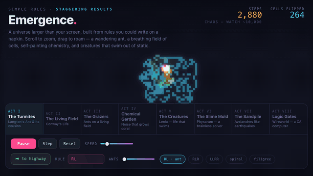

# Emergence

[](https://github.com/Olivesz/emergence/actions/workflows/verify.yml)

**Eight cellular automata, one engine: from a one-line rule to a CPU.**



Rules you could write on a napkin produce structure nobody wrote down. This is an
interactive, single-file web toy that makes that visible, playable in the browser
with no build step and no dependencies. Act VIII climbs from a wire to a working
CPU; [the-stack.html](the-stack.html) walks that ladder rung by rung.

**Live:** [olivesz.github.io/emergence](https://olivesz.github.io/emergence/) ·
[the stack](https://olivesz.github.io/emergence/the-stack.html) ·
[SAP-1 panel](https://olivesz.github.io/emergence/cpu/cpu.html) ·
[SAP-2 debugger](https://olivesz.github.io/emergence/cpu/cpu2.html)

## The acts

| Key | Act | System | What happens |
|---|---|---|---|
| `1` | **I — The Turmites** | Langton's ant, turmites | ~10,000 steps of chaos, then a periodic *highway* builds itself. Editable rule string (`RL`, `RLR`, `LLRR`, …), several ants on one grid. |
| `2` | **II — The Living Field** | Conway's Life | Age-coloured cells; R-pentomino, glider gun, pulsar, or paint your own. |
| `3` | **III — The Grazers** | ant + Life hybrid | Ants turn on the same alive/dead bit Conway's rule reads, so each automaton reshapes the other. |
| `4` | **IV — Chemical Garden** | Gray–Scott reaction–diffusion | Near-uniform noise organises into coral, dividing cells and fingerprints. Drag to inject reagent. |
| `5` | **V — The Creatures** | Lenia | Continuous Life: glowing organisms assemble out of static, swim and divide. |
| `6` | **VI — The Slime Mold** | Physarum agents | Trail-following agents build transport networks; maze modes solve by breadth-first search, A\* and a flow model. [Details](docs/acts.md#act-vi--the-slime-mold-physarum) |
| `7` | **VII — The Sandpile** | Abelian sandpile | One toppling rule grows a self-similar fractal; random rain gives power-law avalanches. |
| `8` | **VIII — Logic Gates → a Computer** | Wireworld | Clock, wire, OR, XOR, AND, a half-adder and a memory loop, each auto-cycling its truth table; then a CPU. [Details](docs/acts.md#act-viii--logic-gates--a-computer-wireworld) |

## Results, and how to check them

Every claim below is printed by a script that exits non-zero when it fails.
`python3 verify.py --fast` runs the push gate (about 90 s, Python 3 stdlib, plus Node
or macOS's JavaScriptCore for the browser engines); `--nightly` adds the slow runs.

| Claim | Command | Time | CI |
|---|---|---|---|
| SAP-1 (1446 NAND + 175 flip-flops) runs 5+3, 9−4, a countdown, a sum and Fibonacci 1…144 | `python3 cpu/run_cpu.py` | <1 s | push |
| SAP-2 (18,895 NAND + 2,118 flip-flops, memory included) runs multiply, divide, GCD, Fibonacci, primes and a bubble sort | `python3 cpu/run_sap2.py` | 25 s | push |
| The browser engines match the Python netlists on every register, every cycle | `python3 cpu/test_js_parity.py` | 30 s | push |
| A full adder, a 4-bit counter and a D flip-flop, compiled to raw Wireworld, match the netlist on every clock | `python3 cpu/test_wwcompile.py`, `cpu/test_dff.py` | 3 s | push |
| The 18-tile Wireworld library: exact timing, truth tables, no backflow, all 8 orientations | `python3 cpu/wwtiles.py` | 1 s | push |
| Act VIII's gates, read from `index.html`, match their truth tables | `python3 cpu/test_toy_gates.py` | 1 s | push |
| Glider gates, Snark, duplicator, a timed crossing, a routed NOR | `python3 verify.py --fast` | — | push |
| A routed half-adder in Life; sums to 682+341 with the half-adder run per bit | `python3 glider-logic/ha_adder.py` | ~3 min | nightly |
| Carlini's 137,712-cell glider adder computes 6+5=11 here (pattern pinned by sha256) | `python3 glider-logic/carlini_adder.py` | ~1 min | nightly |
| Every check above fails when the thing it checks is broken | `python3 verify.py --falsify --nightly` | ~20 min | nightly |

The counts come from `python3 verify.py --stats`, and `tests/test_numbers.py`
fails if any page quotes a different number.

What the Wireworld compiler does and does not do yet is in
[cpu/README.md](cpu/README.md); the glider build's results and walls are in
[docs/glider-findings.md](docs/glider-findings.md).

## Run it

```bash
open index.html
```

Or serve the folder (`python3 -m http.server`) and open it. All pages are single
HTML files with inline CSS and JS.

## Controls

- **Acts:** the tabs, or keys `1`–`8`.
- **Transport:** Play/Pause (`space`), Step, Reset, Speed.
- **Camera:** scroll or pinch to zoom, drag to pan; `F` fits the world, `+`/`−` zoom, arrow keys pan.
- **Per act:** presets under each act; Acts II, IV and V also paint with the mouse
  (switch to ✎ Paint).

## How it is built

One engine with shared grid buffers; only each act's `step*()` and `seed*()`
differ. The world is wider than the screen and rendered once per frame to an
offscreen canvas, then drawn through a single camera transform with a light
bloom pass. In Act III, the coupling between ant and field is one function,
`coupling()`:

```js
ant.dir += alive ? 1 : 3;   // turn right on a live cell, left on a dead one
```

That is Langton's "turn right on one colour, left on the other", with Conway's
life-state as the colour.

## License

MIT — see [LICENSE](LICENSE).
